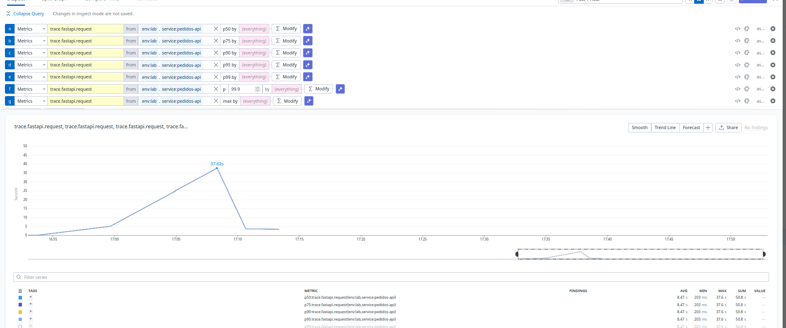
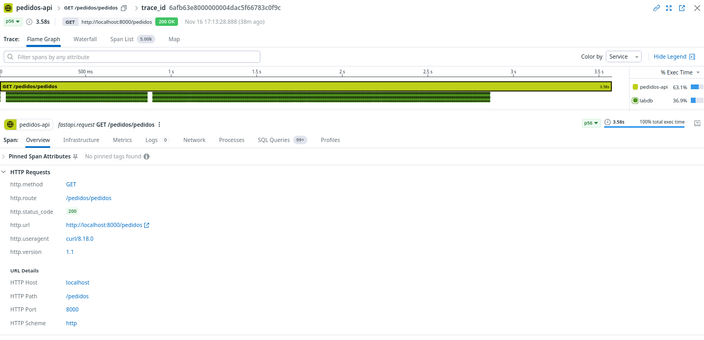
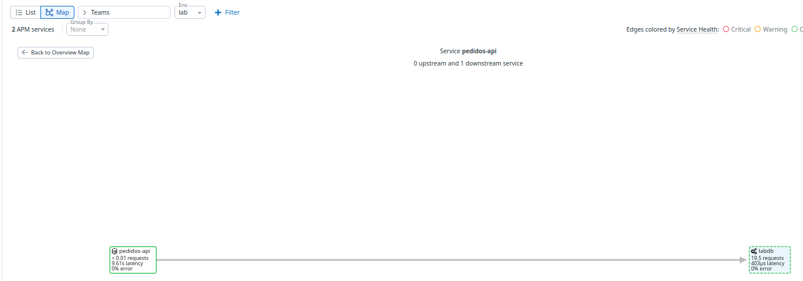
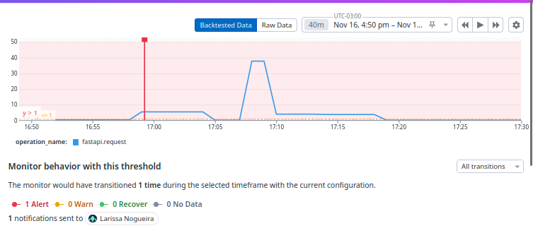

# Lab de Incidente: Diagnóstico de N+1 com Observabilidade

Este projeto é uma simulação prática de um incidente real de performance em uma API Python (FastAPI). O objetivo principal foi utilizar os três pilares da observabilidade (Métricas, Traces e Logs) para diagnosticar e encontrar a causa raiz de uma lentidão severa em produção, além de configurar monitoramento proativo.

## O Cenário Simulado

O endpoint `GET /pedidos` começou a apresentar latência alta. O problema não ocorria no ambiente de desenvolvimento (onde o banco tinha poucos dados), mas explodiu quando o volume de dados e a concorrência aumentaram.

- **Sintoma:** Latência p99 acima de 3,5 segundos no endpoint `/pedidos`.
- **Impacto:** Usuários relatando lentidão extrema na listagem de pedidos.

## A Investigação (O Ciclo de Troubleshooting)

A investigação seguiu o fluxo clássico de observabilidade: Métrica (O Alerta) → Trace (A Localização) → Log (A Confirmação).

### 1. A Métrica (O "Que" está lento)
A primeira evidência veio do dashboard de APM do Datadog. O gráfico de latência mostrou um pico claro, com o p99 estourando a casa dos segundos.


### 2. O Trace (O "Onde" está lento)
Com o trace distribuído do Datadog, analisamos uma requisição específica. A visualização revelou que, de um tempo total de **3.58s**, a esmagadora maioria estava gasta no banco de dados (`labdb`). Na aba **SQL Queries**, foi possível ver o "buraco negro" da requisição: **99+ spans de queries SQL** sendo executadas em loop.


### 3. O Log (O "Porquê" detalhado)
Os logs do container confirmaram a recepção das requisições HTTP 200 OK. Identificamos também uma **oportunidade de melhoria de maturidade**: a falta de *Structured Logging* (JSON) impediu a injeção automática do `trace_id` nos logs, impossibilitando a correlação automática com o APM. Em um ambiente de produção, configuraríamos o Log Injection via `ddtrace` para pular do log direto para o trace.

### 4. Service Map (Visão de Arquitetura)
O mapa de serviços confirmou a dependência: a comunicação entre a nossa API (`pedidos-api`) e o Banco (`labdb`) era o gargalo.


## O Diagnóstico (Causa Raiz)

A causa raiz foi identificada como o clássico **Problema N+1** no ORM (SQLAlchemy). 

No código (`app/main.py`), a query buscava a lista de pedidos, e o *Lazy Loading* do SQLAlchemy disparava uma nova query no banco de dados para cada cliente associado a cada pedido, resultando em milhares de consultas individuais.

### O "Efeito Cache" (Descoberta Técnica)
Durante a simulação, nos deparamos com um comportamento interessante: ao popular o banco com 50.000 pedidos, mas apenas 100 clientes distintos, o N+1 foi *mascarado*. O **Identity Map** do SQLAlchemy salvou os 100 clientes em cache na memória e ignorou as consultas repetidas, resultando em um tempo de resposta artificialmente baixo (~0.2s). 

Para reproduzir o incidente real com precisão, o `seed.py` foi ajustado para criar uma relação **1:1 (5000 pedidos para 5000 clientes únicos)**. Sem o cache para mascarar, o tempo de resposta saltou para **3.86s**, provando o custo real do N+1.

## Monitoramento Proativo (Alerting)

Para garantir que esse tipo de incidente não passe silencioso em produção, foi configurado um **Threshold Alert** no Datadog.
- **Métrica:** Latência p99 do serviço `pedidos-api`.
- **Condição:** Disparar alerta se passar de 1 segundo em uma janela de 5 minutos.
- **Resultado:** O monitor entrou no estado `ALERT` (vermelho) durante a simulação, notificando a equipe.


## A Solução (Fase 2)

A correção do problema envolve alterar o carregamento no SQLAlchemy de *Lazy Loading* para *Eager Loading* (utilizando `joinedload`). Isso força o ORM a fazer um `JOIN` no banco e trazer os pedidos e seus clientes em **apenas 1 query**, eliminando o problema N+1.

## Como reproduzir este laboratório

1. Clone o repositório.
2. Crie o arquivo `.env` na raiz com sua API Key do Datadog (`DD_API_KEY=sua_chave`).
3. Suba a infraestrutura (API, Postgres, Datadog Agent):
   ```bash
   docker compose up -d --build

## Para ler

Para entender mais a fundo os conceitos de métricas, SLOs (Service Level Objectives) e observabilidade que basearam este projeto, recomendo fortemente a leitura do livro **Engenharia de Confiabilidade do Google (Google SRE)**.

- [Site Reliability Engineering (Google)](https://sre.google/sre-book/table-of-contents/) - Leitura gratuita online.
- **Capítulo 4: Service Level Objectives** - Fundamental para entender como definir o que é um "sistema saudável" e como criar alertas que não geram fadiga (alert fatigue).
- **Capítulo 6: Monitoring Distributed Systems** - Explica a diferença entre monitorar causas (métricas internas) vs sintomas (latência percebida pelo usuário).
